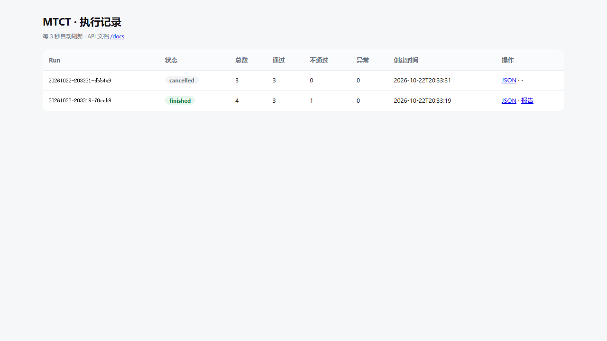
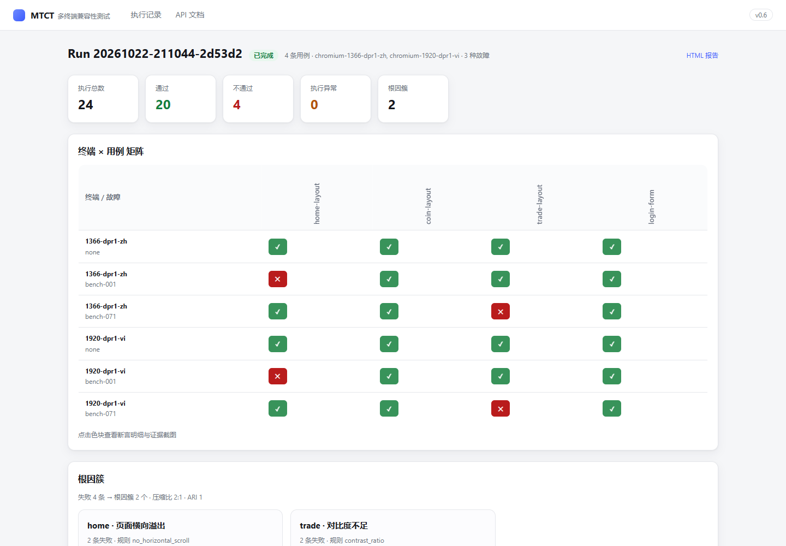
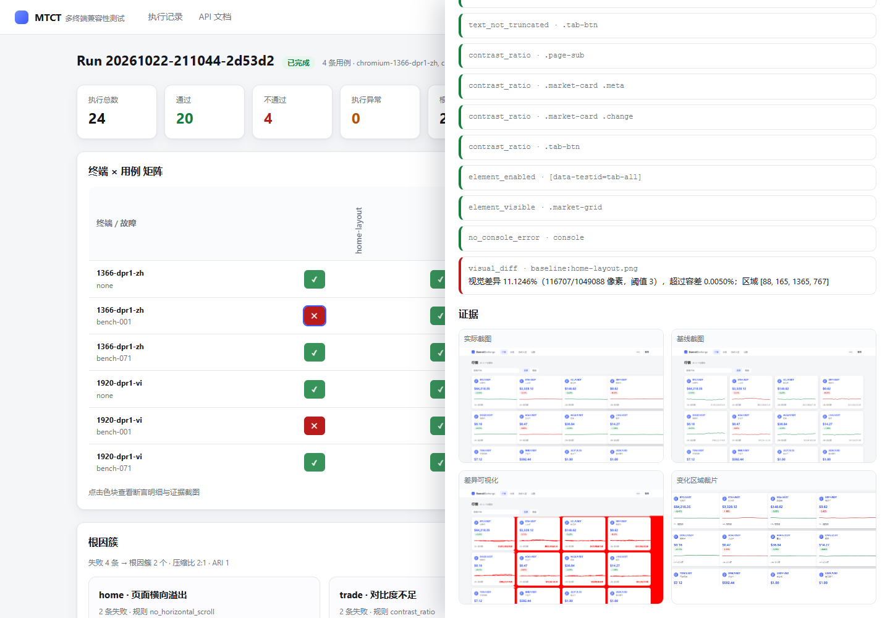

# MTCT · 多终端计算机应用兼容性测试系统

[](https://github.com/hopetree09/mtct/actions/workflows/ci.yml)

> 给一个 Web 应用写一次用例，就能在多种终端环境（浏览器内核 / 分辨率 / 缩放 / 语言 / 网络）上
> 自动执行，用"布局不变量"判定兼容性缺陷，并产出带截图证据的报告。

**当前状态：v0.6** —— 执行 → 断言 → 像素比对 → 报告 → 120 例基准集（**100% 检出、0 基线误报**）已跑通；HTTP API + SQLite + 异步 Run 队列 + 幂等/取消已就绪；失败聚类与根因命名已接入；**前端控制台**（矩阵热力图 / 断言明细 / 证据截图 / 根因簇）已上线；多模态语义判定管线已就绪（配置 API Key 后启用）。

---

## 快速开始

```powershell
# 1) 安装依赖
python -m pip install -r requirements.txt

# 2) 可选：下载 Playwright 内置 Chromium
#    下载失败也没关系：没有内核时会自动回退到系统 Edge
python -m playwright install chromium

# 3) 采集视觉基线（每个终端 × 每条用例一张；首次或 UI 有意变更后执行）
python -m mtct baseline --serve

# 4) 跑一轮（--serve 会自动启动演示站；若 8765 已有服务则直接复用）
python -m mtct run `
  --cases cases/home-layout.yaml cases/trade-layout.yaml cases/login-form.yaml `
  --terminals default `
  --faults none,layout-card-overflow,layout-btn-overlap `
  --serve

# 5) 打开 runs/<run_id>/report.html 看报告

# 6) 对一轮结果的失败做聚类与根因命名
python -m mtct cluster --run runs/<run_id>

# 7) 启动 HTTP API + 控制台
python -m mtct api --port 8000
# 控制台 http://127.0.0.1:8000/ui/  ·  OpenAPI 文档 http://127.0.0.1:8000/docs
```

常用参数：

| 参数 | 说明 |
|---|---|
| `--terminals default\|all\|id1,id2` | 终端档案，见 `mtct/matrix/profiles.py` |
| `--faults none,<id>` | 故障注入模式，`none` 为基线 |
| `--channel msedge` | 指定已安装浏览器通道（不下载内核） |
| `--headed` | 有头模式，方便肉眼观察 |
| `--serve` | 自动启动 `demo/web-app` 静态服务 |
| `--fail-on-failures` | 有失败时返回非零退出码（接 CI 用） |

---

## 目录结构

```
mtct/
  cli.py                  # python -m mtct run ...
  core/models.py          # 终端 / 用例 / 断言结果 / 执行结果
  core/runner.py          # 矩阵展开与执行编排
  adapters/web_playwright.py  # Playwright 适配器（环境注入 + 就绪门控）
  assertions/layout.py    # 布局不变量 + 功能断言
  matrix/profiles.py      # 终端档案
  reports/__init__.py     # 控制台 / JSON / HTML 报告
  visual/diff.py          # 像素比对：变化比例 / 区域 / 证据裁片
  visual/baseline.py      # 视觉基线采集
  ai/triage.py            # 多模态语义判定：缓存 / 预算 / 降级
  api/app.py              # FastAPI：提交 / 查询 / 取消 / 报告 / 看板
  api/db.py               # SQLite：runs / run_cases 持久化
  api/service.py          # 异步 Run 队列：状态机 / 幂等 / 取消 / 增量落库
  clustering.py           # 失败聚类（TF-IDF + HDBSCAN）与根因命名
  web/                    # 前端控制台（零构建 SPA：index.html / app.js / styles.css）
  benchmark.py            # 基准集评测（检出率 / 漏检 / 基线误报）
cases/                    # 用例 DSL（YAML，由 generator 生成）
demo/web-app/             # 自研演示站（被测对象 + 22 条语义故障）
  data/faults.json        # 120 例基准集规格（确定性注入 + 标签）
scripts/gen_benchmark.py  # 基准集与用例生成器（可复现）
baselines/                # 视觉基线（gitignore）
tests/                    # 单元测试（pytest）
runs/                     # 执行产物（报告 + 截图，gitignore）
benchmark/                # 评测报告（gitignore）
```

---

## 用例 DSL

```yaml
key: home-layout
name: 行情页布局与文字完整性
path: /home
assertions:
  - type: layout
    rules:
      - rule: no_horizontal_scroll
      - rule: no_overflow
        selectors: [".market-card"]
      - rule: no_overlap
        pairs: [[".market-card:nth-of-type(1)", ".market-card:nth-of-type(2)"]]
      - rule: text_not_truncated
        selectors: [".market-card .price"]
  - type: functional
    rules:
      - rule: no_console_error
```

### 已实现断言

| 规则 | 类型 | 判定方式 |
|---|---|---|
| `no_horizontal_scroll` | 布局 | `document.scrollWidth` 超过 `clientWidth` |
| `no_overflow` | 布局 | 元素 `getBoundingClientRect` 超出视口 |
| `no_overlap` | 布局 | 两个元素矩形交集面积 > 1px² |
| `in_viewport` | 布局 | 元素完整落在视口内 |
| `text_not_truncated` | 布局 | `scrollWidth/Height` 超过 `clientWidth/Height` |
| `no_console_error` | 功能 | 页面无 console.error / 未捕获异常 |
| `element_enabled` | 功能 | 元素存在且未 disabled |
| `element_visible` | 功能 | 元素可见 |
| `contrast_ratio` | 可读性 | WCAG 对比度低于阈值（默认 3:1） |
| `visual_diff` | 视觉 | 与基线截图的像素差异比例超过容差 |

---

## 缺陷基准集（120 例）

`demo/web-app/data/faults.json` 由 `scripts/gen_benchmark.py` 生成，每条故障都是**确定性注入 + 自带标签**：

| 类别 | 数量 | 注入方式 | 期望检出 |
|---|---|---|---|
| layout | 30 | 元素宽度撑到 1800px | `no_overflow` |
| i18n | 30 | 限宽 18px + 单行 + 隐藏溢出 | `text_not_truncated` |
| contrast | 20 | 前景色 `#f2f2f2`（对比度 < 3:1） | `contrast_ratio` |
| zoom | 10 | 容器固定 1800–3000px 宽 | `no_horizontal_scroll` |
| functional | 15 | 控制台异常 / 按钮 disabled / 内容隐藏 | `no_console_error` 等 |
| loading | 3 | 骨架屏永不消失 | 就绪门控（ready_gate） |
| visual | 12 | 阴影 / 圆角 / 边框 / 透明度变化 | `visual_diff`（像素比对） |

```powershell
# 跑基准集：120 条故障 + 6 个页面基线，约 165 秒
python -m mtct eval --serve
# 报告：benchmark/<run_id>/report.md
```

实测结果（2026-10-22，`chromium-1366-dpr1-zh`）：

| 指标 | 结果 |
|---|---|
| 故障总数 | 120 |
| 检出 | 120（**recall_any = 100%**） |
| 按预期规则检出 | 120（**recall_expected = 100%**） |
| 漏检 | 0 |
| 基线误报 | **0**（6 个页面基线全部通过） |
| 总耗时 | 约 155s |

分类别：7 类全部 100%（`visual` 12/12 由像素比对检出）。
演进过程：只上规则时 108/120（90%），加入像素比对后 120/120（100%），基线误报始终为 0。

---

## 像素比对与 AI 判定

### 视觉基线

```powershell
python -m mtct baseline --serve     # 3 终端 × 6 用例 = 18 张基线
```

基线键 = `内核-分辨率-DPR-语言`（**不含网络**）：弱网终端与正常网络共用同一套基线，
因为门控通过后的画面应当一致。

### 像素比对（规则层）

- 逐像素取三通道最大差，`> 3` 记为"变了"（过滤抗锯齿噪声）；
- 变化比例超过容差即判失败（演示站渲染完全确定，容差收到 0.005%）；
- 产出 diff 可视化图 + 变化区域裁片，作为证据链进入报告。

### AI 语义判定（判定层）

只有**像素已判定有变化**、且用例开启 `visual.triage` 时才调用模型：

| 配置项 | 说明 |
|---|---|
| `MTCT_VLM_API_KEY` | 模型 Key（也兼容 `DASHSCOPE_API_KEY`） |
| `MTCT_VLM_BASE_URL` | OpenAI 兼容地址，默认 DashScope |
| `MTCT_VLM_MODEL` | 默认 `qwen-vl-plus` |
| `MTCT_VLM_MAX_CALLS` | 单轮预算上限（默认 200） |
| 缓存 | `cache/triage.json`，按"裁片哈希 + 上下文 + prompt 版本"去重 |

输出强约束 JSON：`verdict`（true_bug / styling_noise / env_noise / needs_human）、
`category`、`severity`、`confidence`、`reason`。解析失败、超预算、调用异常一律降级
`needs_human`——AI 永远不做最终裁决。

未配置 Key 时自动使用 `NullTriage`，管线照常跑，只是视觉变化全部标记"待人工复核"；
配置 Key 后重跑 `mtct eval`，报告里会出现"AI 判定分布"。

### 单元测试

```powershell
python -m pytest tests -q     # 8 passed
```

---

## 终端档案（`mtct/matrix/profiles.py`）

| id | 分辨率 | DPR | 语言 | 网络 |
|---|---|---|---|---|
| `chromium-1366-dpr1-zh` | 1366×768 | 1 | zh-CN | normal |
| `chromium-1920-dpr1-vi` | 1920×1080 | 1 | vi-VN | normal |
| `chromium-1366-dpr2-en` | 1366×768 | 2 | en-US | normal |
| `chromium-1366-dpr1-zh-weak` | 1366×768 | 1 | zh-CN | weak3g（每请求 +350ms） |

---

## HTTP API（v0.4）

```powershell
python -m mtct api --port 8000
# 看板 http://127.0.0.1:8000/    OpenAPI 文档 http://127.0.0.1:8000/docs
```



| 方法 | 路径 | 说明 |
|---|---|---|
| GET | `/healthz` | 健康检查 |
| GET | `/api/meta` | 可用用例 / 终端 / 故障清单 |
| POST | `/api/runs` | 提交一轮回归，202 返回 Run；支持 `Idempotency-Key` |
| GET | `/api/runs` | 历史 Run 列表 |
| GET | `/api/runs/{id}` | Run 详情 + 每条用例结果 |
| POST | `/api/runs/{id}/cancel` | 取消（用例间隙生效） |
| GET | `/api/runs/{id}/report` | 下载 HTML 报告 |
| GET | `/api/runs/{id}/file?path=` | Run 产物（截图 / diff / trace），限制在 Run 目录内 |
| GET | `/api/baselines/{visual_key}/{case_key}` | 视觉基线截图 |
| GET | `/api/runs/{id}/clusters` | 根因簇 + 聚类指标 |
| POST | `/api/runs/{id}/cluster` | 重新聚类（结果落库后可重算） |

```powershell
$body = @{ cases = @("home-layout","coin-layout"); terminals = @("default"); faults = @("none","layout-card-overflow") } | ConvertTo-Json
Invoke-RestMethod -Method Post -Uri http://127.0.0.1:8000/api/runs -ContentType application/json -Body $body -Headers @{ "Idempotency-Key" = "demo-1" }
```

### 可靠性设计

| 机制 | 实现 |
|---|---|
| 状态机 | `queued → running → finished / failed / cancelled`，落 `runs.status` |
| 幂等 | `runs.idempotency_key` 唯一索引；同 key 重复提交返回已有 Run（200） |
| 增量落库 | 每执行完一条用例立即 upsert `run_cases`，进程崩溃也能看到进度 |
| 取消 | DB 标记 + 每用例回调检查，最多延迟一个用例；已完成结果保留 |
| 队列 | `asyncio.Queue` + 单 worker（单机单浏览器，串行最稳） |
| 失败隔离 | 单个 Run 异常只影响自身，worker 不会退出 |

> 当前是 SQLite + asyncio 队列的最小实现：API 契约和 DB 模型不变，
> 后续换 PostgreSQL + Celery 只是替换 `RunService._execute` 与连接层。

---

## 前端控制台（v0.6）

打开 `http://127.0.0.1:8000/ui/`，零构建 SPA（原生 JS + hash 路由，不需要 npm）。

### Run 详情：终端 × 用例矩阵 + 根因簇



- 矩阵热力图：行 = 终端 × 故障模式，列 = 用例，绿 ✓ / 红 ✕ / 橙 !；
- 顶部统计：执行总数、通过、不通过、异常、根因簇数；
- 根因簇卡片：标签、根因描述、影响终端；
- 运行中的 Run 每 2.5 秒自动刷新。

### 用例详情：断言明细 + 证据三联图



- 点矩阵色块打开抽屉：逐条断言（规则 / 目标 / 原因）；
- 证据图：实际截图、基线截图、差异可视化（红色标出变化像素）、变化区域裁片；
- AI 判定结果（如启用）也会显示在抽屉里。

> 图片通过 `/api/runs/{id}/file` 与 `/api/baselines/...` 提供，
> 服务端做了路径穿越校验（只允许 Run 目录内的文件）。

---

## 失败聚类与根因命名（v0.5）

```powershell
python -m mtct cluster --run runs/20261022-205034
```

一次真实混合轮次（3 终端 × 6 用例 × 4 种注入故障）的结果：

```
失败 12 条 → 根因簇 4 个（压缩比 3.0:1）
----------------------------------------------------------------
簇     根因标签                    成员  影响终端
c1    settings · 控件不可用         3   chromium-1366-dpr1-zh, chromium-1366-dpr2-en, chromium-1920-dpr1-vi
c2    home · 页面横向溢出           3   chromium-1366-dpr1-zh, chromium-1366-dpr2-en, chromium-1920-dpr1-vi
c3    coin · 文案被裁切             3   chromium-1366-dpr1-zh, chromium-1366-dpr2-en, chromium-1920-dpr1-vi
c4    trade · 对比度不足            3   chromium-1366-dpr1-zh, chromium-1366-dpr2-en, chromium-1920-dpr1-vi
----------------------------------------------------------------
ARI(vs 注入故障) = 1.0   ARI(vs 缺陷类别) = 1.0   簇纯度 = 1.0
```

### 特征与算法

| 环节 | 实现 |
|---|---|
| 特征 | 失败规则集合、断言消息模板（数字归一化）、页面、目标元素——**不使用注入标签**，避免指标作弊 |
| 向量化 | TF-IDF（字符 2–3 gram，适配中文，无需分词） |
| 聚类 | HDBSCAN（cosine），孤立点归入"零散失败"桶；退化时回退层次聚类 |
| 命名 | 默认模板命名（页面 + 规则 + 元素 + 影响终端）；配置 `MTCT_LLM_API_KEY` 后 `--llm-name` 可用模型重新命名 |
| 指标 | 压缩比、ARI（vs 注入故障 / vs 缺陷类别）、簇纯度 |

> 说明：当前数据集是自建合成集（每个故障有确定标签），所以 ARI 能到 1.0；
> 真实生产环境要用失败日志 + 人工复核做同样的评测，这一步已预留 `--llm-name` 与指标接口。

聚类结果会随 Run 自动生成：`runs/<run_id>/clusters.json` / `clusters.md`，
API 侧提供 `GET /api/runs/{id}/clusters` 与 `POST /api/runs/{id}/cluster`。

---

## 实测数据（2026-10-22）

**回归矩阵**：3 终端 × 3 故障模式 × 3 用例 = 27 次执行 —— 通过 21，不通过 6，异常 0；
6 条失败全部落在预期位置（`layout-card-overflow` → 行情页 `no_overlap`，
`layout-btn-overlap` → 交易页 `no_overlap`）。单次执行 560–950ms，弱网终端约 3.2s。

**缺陷基准集**：120 条故障 —— 检出 120（100%），基线误报 0，耗时约 155s；
其中 12 条纯视觉故障由像素比对检出（只上规则时为 90%）。

**失败聚类**：混合轮次 12 条失败 → 4 个根因簇（压缩比 3:1），ARI(vs 注入故障)=1.0，簇纯度 1.0；Run 结束自动聚类，API 可查询/重算。

**前端控制台**：24 次执行的 Run（2 终端 × 4 用例 × 3 故障模式）→ 矩阵 6 行 × 4 列、根因簇 2 个、用例证据三图全部正常渲染。

**HTTP API 冒烟**：提交 4 次执行的 Run（2 用例 × 2 故障模式）→ 3 通过 / 1 不通过，报告可下载；同一 `Idempotency-Key` 重复提交返回同一 Run；取消长 Run 后状态为 `cancelled` 且保留已完成结果；未知用例返回 400、未知 Run 返回 404。

---

## 还没做（下一步）

1. 人工标注闭环：在用例抽屉里接受/驳回 AI 判定，回流为 few-shot 样本；
2. PostgreSQL + Celery 替换当前的 SQLite + asyncio 队列（API 契约不变）；
3. pairwise 矩阵生成、Python 原生桌面适配器；
4. 交付打磨：GitHub Actions CI、覆盖率报告、演示视频、简历条目定稿。

---

## 工程与交付

| 内容 | 位置 |
|---|---|
| CI（Python 3.11/3.12：编译检查 + 15 个单测） | `.github/workflows/ci.yml` |
| 演示视频分镜脚本（3 分钟，含旁白与录制清单） | `docs/演示视频脚本.md` |
| 项目说明书（含实测记录与方案偏差） | `项目说明书.md` 附录 D |

> CI 只跑不依赖浏览器的测试；端到端与基准集需要本机 Playwright 内核 + 演示站，
> 命令见 README「快速开始」。

---

## 环境说明

- Windows 10/11 + Python 3.11+；
- 默认使用 Playwright 内置 Chromium；未安装时自动回退系统 Edge（Windows 自带），
  保证在"没有下载内核"的机器上也能先跑通链路。