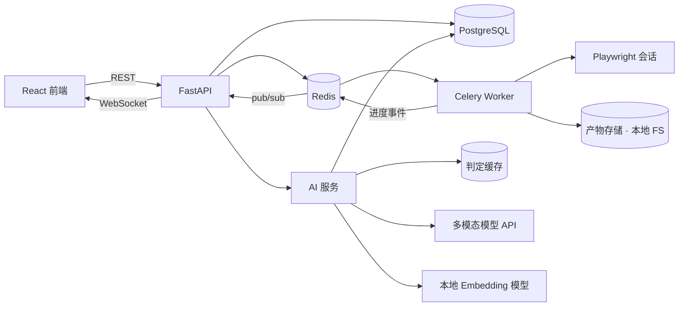

# 多终端计算机应用兼容性测试系统 · 项目说明书

| 项 | 内容 |
|---|---|
| 项目代号 | MTCT（Multi-Terminal Compatibility Tester） |
| 文档版本 | v1.2（追加实测记录与方案偏差） |
| 负责人 | XXX（单人开发） |
| 周期 | 4 周 / 约 150 工时 |
| 目标岗位 | 测试开发 / 后端（Python 方向） |
| 硬件约束 | 仅一台 Windows 10/11 电脑，无云主机、无真机农场 |
| 被测对象 | 自研 Web 演示应用（Vite + 原生 TS，无后端、无框架） |
| 代码归属 | 个人项目，不含任何公司代码、用例、数据、截图 |

> **v1.1 修订说明**
> 1. 作者实习期间的实际工作是「UI 测试用例编写与执行」，共 1000+ 条用例，覆盖中/英/越三语、Edge / Firefox / 百度浏览器，含弱网场景，缺陷记在 Excel。这些真实要素已写入第 1 节并驱动设计。
> 2. 产品形态定为**只做浏览器形态的 Web 应用**（最简单、可行性最高）；Windows 原生桌面程序降级为 P2 扩展点，不占 4 周排期。
> 3. 终端矩阵由「20 组合（含桌面）」改为「22 组合（5 轴 pairwise + 手工补强）」，新增**语言**与**网络**两根轴。

> **v1.2 修订说明**
> 1. 追加「附录 D：实测记录与方案偏差」，把实际交付能力、实测数字、与计划的偏差及后续两周计划一次性写清。
> 2. 本版所有数字来自仓库内可复现的评测（`benchmark/`、`runs/`、`pytest`），未做估算。


---

## 0. 一页纸摘要

**一句话**：给一个 Web 应用写一次用例，就能在 22 种终端环境（3 浏览器内核 × 3 分辨率 × 2 缩放 × 3 语言 × 3 网络）上自动执行，自动判断"这算不算兼容性缺陷"，自动把几百条失败聚成几类根因，并输出带证据链的报告。

**为什么值得做**（源自作者实习亲历）：实习时主要工作就是写 UI 用例、跑 UI 测试——1000+ 条用例，每个版本要在 Edge / Firefox / 百度浏览器下，用中文、英文、越南语三套文案，还要在弱网条件下各跑一遍。真正耗时的不是"点"，而是"等页面加载 + 盯着截图判断这个差异算不算问题"，最后缺陷还只能记在 Excel 里，没法统计、没法复用、没法自动归因。

**技术栈**：Python 3.11 / FastAPI / PostgreSQL / Redis + Celery / Playwright / scikit-learn / 多模态大模型 API / React + AntD + ECharts / Docker Compose / pytest + GitHub Actions

**量化目标**（验收口径，报告实测值）：

| 指标 | 目标 |
|---|---|
| 终端组合 | 22（5 轴 pairwise 18 + 手工补强 4） |
| 用例规模 | 24 条（6 个页面），单轮 528 次执行 |
| 单轮全矩阵回归时长 | ≤ 30 分钟 |
| 任务成功率 | ≥ 98%（连续 3 轮） |
| AI 判定误报率 | ≤ 20%（纯规则基线约 65%–70%） |
| AI 判定召回率 | ≥ 85% |
| VLM 调用率 | ≤ 25%（其余由规则/缓存消化） |
| 单轮 AI 成本 | ≤ ¥2 |
| 失败聚类 | 100 条量级失败 → ≤ 8 个根因簇，纯度 ≥ 0.85 |
| 后端测试覆盖率 | ≥ 70%（core / scheduler / assertions） |

**交付物**：可运行仓库 + README（架构图 / 3 个 GIF / Quickstart）+ 120 例缺陷基准集 + 评测报告 + Excel 导出 + 3 分钟演示视频 + 3 条简历条目。

**明确不做**：不做设备云、不做分布式多机调度、不做移动端真机、不做原生桌面程序（留接口）、不做 SaaS 多租户、不接入公司任何系统与数据。

---

## 1. 背景与问题定义

### 1.1 真实痛点（作者实习亲历，项目的需求来源）

作者在 某数字资产交易平台实习期间，主要工作内容是 **UI 测试用例的编写与执行**。真实情况是：

| 维度 | 实际情况 |
|---|---|
| 用例规模 | 1000+ 条 UI 测试用例 |
| 语言 | 中文、英文、越南语三套文案 |
| 浏览器 | Edge、Firefox、百度浏览器 |
| 网络 | 包含弱网（限速/丢包）条件下的验证 |
| 记录方式 | 用例与缺陷记录都在 Excel 里维护 |
| 典型缺陷 | 按钮文字超出按钮长度、UI 显示不全、文案截断 |
| 执行体感 | 一轮回归要在多浏览器 × 多语言 × 弱网下反复手点、截图、肉眼比对 |

这套流程的瓶颈非常清楚：

1. **重复劳动**：同一条用例，在 3 种浏览器 × 3 种语言下要人工做 9 次；
2. **判断靠肉眼**：截图差异里混着真实缺陷、字体渲染差异、加载中状态、动画残影，人看久了必然漏判、误判；
3. **结果不可统计**：Excel 里记录的是"点过没点过"，无法回答"这轮比上轮多了几个缺陷""哪个环境最容易出问题"；
4. **无法归因**：同一个原因（例如越南语文案过长）可能导致几十条用例失败，但人看到的只是几十行红色记录。

### 1.2 现有方案的不足

| 方案 | 优点 | 不足 |
|---|---|---|
| BrowserStack / LambdaTest / Testin 等设备云 | 终端覆盖全 | 贵；结果判定仍要人工看图；归因和报告不能定制；数据不能私有化 |
| Applitools 等视觉 AI 比对 | 视觉 diff 准 | 只解决"比对"，不解决"跨端归因"；按图收费；与自有流程集成成本高 |
| 自研 Playwright + 截图 diff 脚本 | 便宜、灵活 | diff 误报多（动画、字体抗锯齿、加载态）；失败不成簇；没有报告体系 |
| 纯人工 + Excel（实习时的做法） | 判断准、门槛低 | 慢、不可重复、不可统计、不可归因；1000+ 条用例维护成本极高 |

**结论**：执行层（浏览器自动化）已经很成熟，缺的是"**判定** + **归因** + **可交付报告**"这一段，而这一段恰好适合用 AI 做，也恰好是测试开发岗位的核心能力。

### 1.3 项目定位

不做"又一个自动化测试平台"，做**兼容性回归的 AI 判定与归因层**：

1. **执行**：抽象终端，复用 Playwright 在 22 种终端配置上真实执行；
2. **判定**：布局不变量负责"证明违规"，像素 diff 负责"发现变化"，多模态模型负责"语义定性"，三级配合压误报；
3. **归因**：把失败用例聚类成根因簇，用 LLM 给簇命名并给修复建议；
4. **证明**：用缺陷注入构造带 ground truth 的 120 例基准集，量化"AI 到底提升了多少"。

---

## 2. 目标与成功标准

### 2.1 目标

- **G1（工程）**：一套可复现的任务编排系统，支持"用例 × 终端矩阵"的并发执行、幂等重试、异常隔离、产物归档。
- **G2（执行）**：用例 DSL 能驱动 3 个浏览器内核，正确注入分辨率、缩放、语言、网络四类环境变量，并在弱网下稳定截图。
- **G3（判定）**：三级判定流水线，误报率相对纯规则基线下降 ≥ 60%，且成本可控、可审计。
- **G4（归因）**：失败自动聚类 + 根因命名 + 证据链，人工归因耗时下降 ≥ 70%。
- **G5（可信）**：120 例缺陷基准集 + 一键复跑评测脚本，所有数字可复现。

### 2.2 成功标准（可验收）

见第 13 节 DoD 清单。核心口径：**任何写进简历的数字，都必须能从仓库里的评测报告重现**。

### 2.3 不做什么（Non-goals）

- 不追求终端数量（22 个组合足够证明方法，不追 200 个）；
- 不做跨机器分布式调度（本机多进程即可，架构上留扩展点）；
- 不做移动端、不做原生桌面程序（用 Adapter 接口预留，见 §6.5）；
- 不做 LLM 微调（API + few-shot + 缓存性价比更高）；
- 不接入公司任何内部系统、用例、数据。

---

## 3. 范围与终端矩阵

### 3.1 终端抽象（Terminal Profile）

终端 = 一份可声明、可序列化、可版本化的配置，而不是"某台机器"。执行器只认 Profile，不认硬件——这是把"真实设备农场"压缩到一台电脑的关键。

```yaml
id: chromium-1366x768-dpr2-vi-weak
engine: chromium          # chromium | firefox | webkit
display: { width: 1366, height: 768, dpr: 2.0 }
locale: vi-VN             # zh-CN | en-US | vi-VN
network: weak3g           # normal | weak3g | lossy
visual_key: chromium-1366x768-dpr2-vi   # 基线键：不含网络
tags: [weak-network, high-risk]
```

```yaml
id: firefox-1920x1080-dpr1-en-normal
engine: firefox
display: { width: 1920, height: 1080, dpr: 1.0 }
locale: en-US
network: normal
visual_key: firefox-1920x1080-dpr1-en
```

**关键设计：`visual_key` 与网络解耦。** 只要"就绪门控"可靠，弱网终端在加载完成后的画面应当与正常网络一致，因此像素基线按 `visual_key` 建立、可跨网络复用；网络差异体现在耗时与加载态断言上，而不是基线。这避免了"每个网络条件都要重新拍一套金标"的维护灾难。

### 3.2 矩阵轴与规模

| 轴 | 取值 | 数量 | 模拟方式 |
|---|---|---|---|
| 浏览器内核 | Chromium（代表 Edge / 百度 / Chrome，均为 Blink 系）、Firefox、WebKit（代表 Safari） | 3 | Playwright 内置三内核 |
| 分辨率 | 1366×768 / 1920×1080 / 2560×1440 | 3 | `context.viewport` |
| 缩放（DPR） | 1.0 / 2.0 | 2 | `context.device_scale_factor` |
| 语言 | zh-CN / en-US / vi-VN | 3 | `context.locale` + 应用 i18n |
| 网络 | 正常 / 弱网 3G（400ms 延迟、~400kbps）/ 极弱丢包（800ms、5% 丢包） | 3 | `page.route` 延迟/中止（跨内核）；Chromium 额外用 CDP 精确限速 |

全排列 162 种。用 **pairwise（贪心 IPOG 简化版，约 120 行）** 压到 18 组，再手工补 4 组高风险组合：

- 越南语 + 1366 宽 + 2x 缩放（最容易出截断）；
- WebKit + 2x 缩放（渲染差异最大）；
- 弱网 + 首屏（加载态最不稳定）；
- Firefox + 2x 缩放（DPR 处理差异）。

**最终 22 个终端组合。** pairwise 生成本身是完整的小算法模块，既省执行量，也是"为什么不做全排列"的面试素材。

> 说明：百度浏览器与 Edge 同属 Chromium/Blink 系，用 Chromium 内核代表，品牌差异（UA、内置扩展、旧内核版本）通过 UA 覆盖和"旧内核近似"覆盖；真实品牌浏览器不在本项目范围内，README 如实说明。

### 3.3 用例范围

自研演示应用共 6 个页面，24 条用例：

| 页面 | 用例数 | 覆盖点 |
|---|---|---|
| 登录 | 4 | 表单校验、错误提示布局、按钮防重复提交、键盘操作 |
| 首页（行情列表） | 6 | 卡片布局、数字格式化、长列表滚动、骨架屏、i18n 文案 |
| 详情 | 4 | 图表容器、按钮文字溢出、返回导航、图片加载失败占位 |
| 设置 | 3 | 主题切换、语言切换、开关控件对齐 |
| 表单 | 4 | 输入校验、长文案换行、必填标记、错误态颜色对比度 |
| 全局 | 3 | 导航栏、响应式断点、越南语变音符号渲染 |

**单轮执行量**：22 × 24 = 528 次。

### 3.4 约束与已知限制（写进 README，不藏）

1. **只覆盖浏览器形态**：Windows 原生桌面程序、移动端、macOS 均不覆盖（桌面留 Adapter 接口）。
2. **系统级 DPI/语言不切换**：全部通过浏览器上下文模拟，覆盖的是应用层布局与国际化逻辑，不是操作系统级适配。
3. **WebKit 是 Playwright 构建版**，与真机 Safari 渲染存在差异，作为"跨内核差异"的代表而非 Safari 精确替代。
4. **品牌浏览器不覆盖**：百度浏览器、Edge 的具体版本行为不在范围内。
5. **弱网为软件模拟**（延迟 + 限速 + 丢包），不涉及真实网络抖动与 DNS 故障。
6. **演示应用是自研的**，真实业务系统的复杂样式与组件库不在覆盖范围。

---

## 4. 总体架构

### 4.1 组件



职责边界：

- **API 层**：只做编排与查询，不执行任何用例；创建 Run 后立刻返回 202，执行全部异步。
- **Worker**：把 Run 展开成 RunCase，按终端配置执行；进度写 Redis，结果落库，产物落 FS。
- **AI 服务**：独立模块（可同进程，也可拆进程），输入是产物 + 上下文，输出结构化 JSON，所有调用落 `ai_decisions` 表可审计。
- **前端**：只消费 REST/WS，不参与计算。

### 4.2 数据流（一次 Run）

1. `POST /api/runs`：传 `app_id` + 用例集/标签 + 终端选择（或矩阵生成参数）→ 落 `runs`（status=queued）→ 展开 `run_cases`（幂等键 `run_id+case_id+terminal_id`）→ 投递 Celery 任务 → 返回 202。
2. Worker 领取 → `run_cases.status=running` → 准备 terminal context（viewport/DPR/locale/网络）→ 逐条执行步骤。
3. 截图前走**就绪门控**（应用就绪标记 + 网络空闲 + 图片加载完成，超时记 `inconclusive`）。
4. 视觉类断言：像素 diff → 规则层 → 不确定的调 VLM → 写 `diffs` + `ai_decisions`。
5. Run 全部结束 → 汇总统计 → 触发聚类 → 生成报告（HTML/MD/JSON/Excel）→ `status=finished`。
6. 前端通过 WS 实时看矩阵热力图；详情页展示 baseline/actual/diff 三联图 + AI 判定卡 + 人工标注。

### 4.3 技术选型与理由

| 层 | 选择 | 理由 | 备选与否决原因 |
|---|---|---|---|
| Web 后端 | FastAPI + Pydantic v2 | 异步、类型友好、自带 OpenAPI，便于做契约测试 | Django 太重；Flask 缺校验 |
| 队列 | Celery + Redis | 成熟、`acks_late` 支持至少一次、便于讲清可靠性设计 | 自写 asyncio 调度能展示深度，但 4 周内可靠性风险大 |
| 数据库 | PostgreSQL 16 | JSONB 存 DSL/指标、并发可靠 | SQLite 并发写弱（保留降级方案，见风险 R2） |
| 产物存储 | 本地 FS（内容寻址） | 单机不需要对象存储 | MinIO 增加运维成本，抽象接口留 S3 扩展 |
| 执行 | Playwright（Python） | 三内核一套 API，viewport/DPR/locale/网络全部可注入 | Selenium 慢且配置繁琐 |
| 弱网 | `page.route` 延迟/中止 + Chromium CDP 限速 | 跨内核可用，且能精确控制 | 只用 CDP 则 Firefox/WebKit 不可用 |
| 向量 | FAISS / numpy 暴力检索 | 数据量小（万级），够用 | Milvus 过度设计 |
| Embedding | bge-small-zh-v1.5（本地） | 100MB 级、CPU 可跑、零成本 | bge-m3 更准但更大，作为可选升级 |
| 聚类 | sklearn HDBSCAN / Agglomerative | 无需预设簇数、支持噪声点 | KMeans 需指定 K，对离群点敏感 |
| Excel 导出 | openpyxl | 承接旧习惯（实习时缺陷记在 Excel），降低迁移成本 | CSV 不支持样式与多 sheet |
| 前端 | React + Vite + AntD + ECharts | 一周内出 4 个页面的最快组合 | 无（选熟手） |

### 4.4 目录结构

```
mtct/
  api/            # FastAPI 路由、依赖、Pydantic 模型
  core/           # 配置、DB、ORM 模型、日志、指标、异常
  scheduler/      # Celery app、run 展开、进度事件、重试策略
  adapters/       # base(协议) / web_playwright / (预留 desktop/linux/android)
  matrix/         # 终端 profile、pairwise 生成、网络与显示注入
  assertions/     # 布局不变量、像素 diff、就绪门控、断言注册表
  ai/             # 三级判定、聚类、embedding、LLM 客户端、缓存与预算
  reports/        # HTML / Markdown / JSON / Excel 报告
  cli.py          # mtct run / mtct eval / mtct gen-matrix / mtct gc
web/              # React 前端
demo/
  web-app/        # 自研演示站（Vite + 原生 TS，6 页面，3 语言，就绪钩子，故障开关）
  injector/       # 缺陷注入清单、标签生成、120 例基准集
tests/
  unit/ integration/ e2e/ eval/
docs/             # 说明书、ADR、DSL 规范、评测报告
```

---

## 5. 后端设计

### 5.1 任务模型与状态机

```
run:       queued → running → finished | failed | cancelled
run_case:  queued → running → passed | failed | error | timeout | skipped
attempt:   created → running → passed | failed | error | timeout
```

- `failed`：断言不通过（真实疑似缺陷）。
- `error`：环境/代码异常（浏览器崩溃、页面崩溃、路由异常）→ 可重试。
- `timeout`：超过单用例预算（默认 120s，弱网用例可单独放宽）→ 可重试。
- `skipped`：终端/用例不适用（如某断言仅 Chromium 支持）→ 不计入统计分母。
- `inconclusive`：就绪门控超时、页面未达稳定态 → 不判缺陷，计入"稳定性待观察"。

### 5.2 调度与可靠性

| 机制 | 设计 |
|---|---|
| 至少一次投递 | Celery `acks_late=True`、`task_reject_on_worker_lost=True` |
| 幂等 | `run_cases` 唯一键 `(run_id, case_id, terminal_id)`；Worker 进入时 `SELECT ... FOR UPDATE` + 状态机校验，已是终态则直接返回 |
| 重试 | 仅 `error/timeout` 重试，≤2 次，指数退避（5s/20s）；`failed` 不重试 |
| 假失败治理 | `failed` 用例自动重跑 1 次：通过 → 标记 `flaky`（单列看板，不计入缺陷）；仍失败 → 确认缺陷候选 |
| 超时 | 单用例预算 + 单 Run 总预算；Celery `time_limit` 兜底 |
| 进程回收 | 每个 RunCase 独立 browser context，结束必关；Run 结束强制关闭 browser；残留进程巡检 |
| 资源控制 | 全局并发上限（默认 4）；弱网用例单独限流，避免延迟任务占满 worker |
| 公平性 | 队列按任务类型拆分（`q-run` / `q-priority`）；smoke 用例走优先级队列 |
| 取消 | `POST /runs/{id}/cancel` 置取消标记，Worker 在步骤间检查并优雅退出 |
| 就绪门控 | 统一 `wait_ready()`：应用就绪标记 → 网络空闲 → 图片加载完成，三级全部满足才截图，超时 → `inconclusive` |

### 5.3 数据模型（核心表）

| 表 | 关键字段 | 说明 |
|---|---|---|
| `projects` | id, name | 单项目足够，保留字段 |
| `apps` | id, project_id, name, entry, version | 被测应用（Web） |
| `terminal_profiles` | id, project_id, name, spec(JSONB), visual_key, enabled | 终端定义 |
| `test_cases` | id, app_id, case_key, name, dsl(JSONB), yaml_text, tags, priority, version | 用例 |
| `runs` | id, app_id, name, status, trigger, matrix_snapshot(JSONB), stats(JSONB), started_at, finished_at | 一轮回归 |
| `run_cases` | id, run_id, case_id, terminal_id, status, attempt, duration_ms, summary(JSONB), UNIQUE(run_id,case_id,terminal_id) | 执行明细 |
| `attempts` | id, run_case_id, n, status, error_type, log_ref | 重试记录 |
| `artifacts` | id, run_case_id, kind, path, sha256, size, meta(JSONB) | 截图/日志/trace/录像 |
| `diffs` | id, run_case_id, baseline_id, actual_id, ssim, bbox, diff_ratio | 像素级差异 |
| `ai_decisions` | id, subject_type, subject_id, stage, model, prompt_version, input_hash, output(JSONB), verdict, confidence, tokens, cost, latency_ms, cached | AI 可审计 |
| `labels` | id, diff_id, human_verdict, category, severity, source(injected/manual) | ground truth |
| `clusters` | id, run_id, label, root_cause, member_count, representative_id | 根因簇 |
| `feedback` | id, ai_decision_id, accepted, corrected_verdict, note | 人工回流，进 few-shot 池 |

设计要点：

- **一切判定可追溯**：AI 输出必须落库，带 model、prompt_version、input_hash、cost，能回答"这个结论是哪个模型、什么提示词下的产物"。
- **ground truth 独立成表**：注入缺陷产生的标签与人工标签同表不同 source，评测只取 `source=injected`。
- 指标用 JSONB 而非宽表，避免 4 周内反复改表。

### 5.4 API 设计

| 方法 | 路径 | 说明 |
|---|---|---|
| POST | `/api/projects`、`/api/apps`、`/api/terminals`、`/api/cases` | 基础资源 CRUD |
| POST | `/api/matrix/preview` | 传轴定义，返回 pairwise 结果（生成前预览） |
| POST | `/api/cases/validate` | DSL 静态校验（步骤名、定位器、断言参数） |
| POST | `/api/runs` | 创建 Run，返回 202 + run_id |
| GET | `/api/runs`、`/api/runs/{id}`、`/api/runs/{id}/matrix` | 列表 / 详情 / 矩阵聚合 |
| POST | `/api/runs/{id}/cancel` | 取消 |
| GET | `/api/run-cases/{id}` | 明细 + 步骤级结果 |
| GET | `/api/run-cases/{id}/artifacts` | 产物列表 |
| GET | `/api/diffs`、`/api/diffs/{id}` | 差异列表 / 详情（三联图数据） |
| POST | `/api/diffs/{id}/label` | 人工标注（写 labels + feedback） |
| POST | `/api/runs/{id}/cluster` | 手动触发聚类（默认结束后自动） |
| GET | `/api/clusters/{id}` | 簇详情、代表用例、影响终端 |
| GET | `/api/reports/{run_id}.{html\|md\|json\|xlsx}` | 报告（xlsx 兼容实习时的 Excel 习惯） |
| WS | `/ws/runs/{id}` | 进度事件（run_case 状态变更） |
| GET | `/api/metrics/summary` | 指标看板聚合 |
| GET | `/healthz` | 存活 + 依赖检查 |
| GET | `/api/ai/usage` | token/成本/调用率（预算守卫用） |

约定：错误统一 `{code, message, detail, trace_id}`；列表统一游标分页；时间统一 UTC ISO8601；写接口支持 `Idempotency-Key` 头。

### 5.5 产物存储

- 内容寻址：`artifacts/{sha256[:2]}/{sha256[2:4]}/{sha256}.{ext}`，天然去重（同一 baseline 只存一份）。
- 元数据入 `artifacts` 表，DB 只存路径不存二进制。
- 基线版本：`baseline/{app_id}/{visual_key}/{case_key}/{version}.png`，版本号随人工确认递增。
- 保留策略：非基线产物保留最近 20 轮，超期 `mtct gc` 清理。
- 后续换 S3 只需实现 `ArtifactStore` 接口（`put/get/url`），业务代码零改动。

### 5.6 可观测性

- 结构化日志（structlog）：`trace_id`（= run_id + run_case_id）贯穿 API → Worker → AI；
- 指标（Prometheus 文本端点）：队列深度、用例时延 P50/P95、成功率、VLM 调用数/成本、缓存命中率、`inconclusive` 比例；
- 每次执行留存 Playwright trace / 录屏，作为"证据链"（演示时非常好用）。

---

## 6. 执行层设计

### 6.1 用例 DSL（YAML）

```yaml
case_key: home-price-card-i18n
name: 越南语下行情卡片按钮文字不溢出
app: demo-web
tags: [layout, i18n, visual]
priority: P0
steps:
  - action: goto
    url: /home
    wait_ready: true
  - action: click
    target: { testid: "market-card-1" }
  - action: wait_ready
  - action: assert_layout
    rules:
      - no_horizontal_scroll
      - text_not_truncated: [".price-btn", ".card-title"]
      - in_viewport: [".primary-btn"]
      - no_overlap: [[".card-a", ".card-b"]]
  - action: assert_visual
    baseline: home-price-card
    masks: ["#clock", ".avatar", ".chart-canvas"]
    tolerance: 0.002
    semantic_triage: true
  - action: assert_perf
    rules:
      - ready_within_ms: 6000
      - first_screen_within_ms: 3000
  - action: assert_functional
    rules:
      - no_console_error
      - element_enabled: ".primary-btn"
```

设计原则：

- **动作少而稳**：goto / click / input / select / scroll / wait_ready / 截图 / 断言，共 8 类，避免 DSL 变成编程语言；
- **断言分三级**：布局不变量（确定性、零成本、可直接定位到元素）→ 像素（发现未知变化）→ 语义（定性）。**规则优先，AI 兜底**；
- **定位器回退链**：`testid`（优先）→ `text` → `css/xpath` → 视觉定位（P2），每级失败自动降级并记录命中层级（稳定性数据来源）；
- **就绪契约**：被测应用必须暴露 `window.__MTCT_READY__` 与 `data-testid`，这是"可测性设计"，也是测试开发与开发协作的真实议题。

### 6.2 Web 适配器

- 每终端一个持久化 `browser_context`：`viewport`、`device_scale_factor`、`locale`、`timezone_id`、`color_scheme` 全部注入；
- 截图前注入 CSS 冻结动画/过渡/光标：`*{animation:none!important;transition:none!important;caret-color:transparent!important}`；
- 动态区域 mask（时间戳、随机 ID、图表 canvas）；
- 字体一致性：演示站自带字体（含越南语字形），避免宿主机字体差异污染 diff；
- 就绪门控（见 §6.3）；
- 断言可直接读 DOM 几何：`getBoundingClientRect` 计算溢出/重叠/截断，比像素更可靠且可解释。

### 6.3 弱网与加载态（本项目最容易翻车的地方）

弱网不是"把网速调慢再截图"这么简单，它会让截图落点变得不确定，进而制造大量假缺陷。设计如下：

1. **跨内核弱网模拟**：`page.route` 对静态资源注入延迟、对指定请求注入失败（模拟丢包/超时）；Chromium 额外用 CDP `Network.emulateNetworkConditions` 做真实带宽/延迟模拟。
2. **就绪门控（三重）**：应用就绪标记 → `networkidle` → 所有图片 `complete`；任一超时 → `inconclusive`，不判缺陷。
3. **加载态识别**：若截图时仍检测到骨架屏/loading 类名/首屏占位，直接标 `inconclusive`，不送 AI 判定——避免把"正在加载"误判成"UI 崩了"。
4. **弱网专属断言**：首屏时间、就绪时间、失败重试提示是否出现、按钮是否防重复提交、错误态布局是否错乱。
5. **弱网不进入视觉基线**（`visual_key` 不含网络），门控通过后的画面应与正常网络一致；若不一致，反而是高价值缺陷信号。

### 6.4 跨终端一致性比对（区别于普通回归）

两种比对模式必须分开，否则会因为"不同终端本该长得不一样"而刷出一堆假缺陷：

| 模式 | 比较对象 | 方法 | 能发现 |
|---|---|---|---|
| 回归比对 | 同终端（同 visual_key）的历史基线 | 像素 diff + AI 判定 | 版本迭代引入的视觉回归 |
| 跨端一致性 | 同语言、同 DPR 的不同内核 / 不同分辨率归一化后 | **DOM 几何关系 + 关键样式 + 文案**，不做像素比较 | 布局结构性差异、溢出、截断、控件错位、越南语变音符号被裁切 |

跨端一致性用规则 + 归一化几何（元素相对视口的位置/尺寸比例、元素顺序、可见性、截断标记、`line-height` 与字体度量）判定，AI 只负责解释"这是设计差异还是缺陷"。

### 6.5 扩展点（P2，不排期）

```python
class Adapter(Protocol):
    def prepare(self, terminal: TerminalProfile) -> None: ...
    def launch(self, app: AppSpec) -> Session: ...
    def execute(self, case: TestCase) -> CaseResult: ...
    def capture(self) -> list[Artifact]: ...
    def teardown(self) -> None: ...
    def health_check(self) -> bool: ...
```

Windows 原生桌面（pywinauto + 截图 + 视觉定位）、Linux（WSLg / Docker+Xvfb）、Android（AVD + ADB）都只需实现该协议即可接入，README 写明扩展方式与代价。

---

## 7. AI 能力设计

### 7.1 总览与降级策略

```
断言产出的原始信号
  ├── 布局不变量违规  → 直接判缺陷（确定性，不调 AI）
  ├── 像素 diff
  │     ├── Stage 0 规则：SSIM ≥ 0.995 或 diff 面积 < 阈值 → pass
  │     ├── Stage 1 结构：连通域分析，过滤抗锯齿/字体渲染噪声
  │     ├── Stage 2 语义：多模态模型判定（仅剩余不确定样本）
  │     └── 置信度低 / 调用失败 / 预算耗尽 → needs_human（进人工队列）
  └── 功能/性能异常   → 规则判定
```

**核心原则：AI 不承担"是否 pass"的最终裁决，只负责"变化是否语义相关"的定性，且永远保留 `needs_human` 出口。**

### 7.2 视觉差异语义判定（P0）

**输入**：baseline 与 actual 的 diff 裁剪图（含 2× padding 上下文）、OCR 文本、DOM 局部信息（元素名、bbox、是否 i18n 文案、字体度量）、终端元数据（locale、dpr、内核、网络）、历史同区域标签。

**输出（JSON Schema 强约束）**：

```json
{
  "verdict": "true_bug | styling_noise | env_noise | needs_human",
  "category": "layout | i18n | dpi | color | font | functional | loading",
  "severity": "blocker | major | minor",
  "confidence": 0.0,
  "reason": "一句话中文解释",
  "evidence": ["按钮文字宽度 156px > 容器 132px", "越南语变音符号被 line-height 裁切"]
}
```

**工程要点**：

- temperature=0，JSON Schema 校验，失败重试 1 次，仍失败降级 `needs_human`；
- few-shot 池来自人工标注（20–40 条，覆盖 4 个 verdict，优先覆盖越南语与弱网样本）；
- 缓存键 = `sha256(diff 图 bytes + 上下文摘要 + prompt_version + model)`；
- 预算守卫：单日 token 上限 + 单 Run 上限，超限自动降级规则判定并告警；
- 模型抽象 `VLMClient(base_url, model, key)`，兼容 OpenAI 协议，切换供应商不改业务代码。

**预期效果**：纯规则基线误报约 65%–70%（动画残影、字体抗锯齿、时间戳、越南语换行），加入 Stage 2 后目标 ≤ 20%，同时只有 ≤25% 的 diff 需要付费调用。

### 7.3 失败聚类与根因（P0）

**特征**：日志模板（Drain3）签名、断言消息与错误码、截图 OCR 文本、文本 embedding（bge-small-zh，本地）、数值特征（diff 面积、受影响元素数、语言、内核、网络）。

**聚类**：标准化后 HDBSCAN（`min_cluster_size=2`），噪声点单独成"零散失败"桶，不强聚。

**命名**：每簇取 3 个代表样本（离簇中心最近）+ 影响终端分布 → LLM 输出 `{label, root_cause, affected_terminals, suggestion, confidence}` → 人工可编辑并回写。

**评测**：用注入缺陷的族别作为 ground truth，算 ARI 与"压缩比"（N 条失败 → M 个簇）。

### 7.4 自然语言生成用例（P2，可砍）

`"把语言切成越南语，检查首页按钮文字不被截断"` → LLM 生成 DSL YAML → Schema 校验 → 试运行 + 定位器自修复（最多 2 轮）。

价值：演示效果最好；风险：挤占核心时间。**默认砍，除非前 3 周提前完成。**

### 7.5 成本与安全

- 只把截图裁片（几 KB）送模型，不上整图；
- 全部样例来自自研演示站，不含任何用户数据/公司数据；
- prompt 中不出现可被注入执行的指令，模型输出只做白名单枚举校验；
- 所有 AI 事实（模型版本、prompt 版本、输入哈希、成本）可审计，满足"AI 结论可复核"。

---

## 8. 评测方案：缺陷基准集

> 这一节是项目可信度的关键。没有它，AI 部分只是"讲故事"。

### 8.1 缺陷注入

自研演示站内置**故障注册表**：`?fault=overflow-btn` 即可激活一个确定性缺陷变体。7 类缺陷 × 约 17 个变体 ≈ **120 例带自动标签的样本**。

| 类别 | 注入方式 | 期望被谁发现 |
|---|---|---|
| 布局溢出/重叠 | 固定宽度、绝对定位、负 margin | 布局不变量 |
| 国际化截断 | 越南语/德语长词替换、`white-space: nowrap` | 布局不变量 + 视觉 |
| 缩放错位 | 固定 px 尺寸不随 DPR 缩放 | 视觉 + 跨端一致性 |
| 变音符号裁切 | 越南语叠音 + 紧凑 `line-height` | 视觉 + 字体度量规则 |
| 颜色/对比度 | 前景色贴近背景色 | WCAG 对比度规则 |
| 字体回退 | 移除自定义字体、模拟缺字 | 视觉 |
| 加载态/功能破坏 | 骨架屏卡死、请求 500、按钮禁用、控制台报错 | 功能断言 + 弱网断言 |

标签由注入器自动生成（`is_bug`、category、severity、期望检出方式），120 条不需要人工标；另保留 30–50 条人工标注用于校验注入标签质量。

### 8.2 指标定义

| 指标 | 公式 | 说明 |
|---|---|---|
| 误报率 FPR | FP / (TP + FP) | 系统报缺陷中实际不是缺陷的比例 |
| 召回率 Recall | TP / (TP + FN) | 注入缺陷被检出的比例 |
| 判定一致率 | 与人工标注一致条数 / 总条数 | 用于 few-shot 调优 |
| VLM 调用率 | VLM 调用数 / 总 diff 数 | 成本控制核心 |
| 单轮成本 | Σ(tokens × 单价) / Run | 报告里给出人民币 |
| 压缩比 | 失败条数 / 簇数 | 归因效率 |
| 聚类纯度 | ARI（vs 注入族别） | 聚类质量 |
| 归因耗时 | 从 Run 结束到根因确认（人工计时，10 次均值） | 价值证明 |
| 单轮时长 / P95 用例时延 / 成功率 / inconclusive 比例 | 常规工程指标 | 稳定性 |

### 8.3 评测流程

```bash
# 一键复跑：切换 rule-only / rule+ai 两种配置，产出对比报告
mtct eval --dataset demo/injector/cases.json --config rule-only
mtct eval --dataset demo/injector/cases.json --config rule+ai
# 输出 reports/eval-YYYYMMDD.md + eval-*.json（可直接进 README / 简历）
```

报告固定包含：混淆矩阵、FPR/Recall、调用率、成本、耗时、按类别拆分，以及**至少 5 个 bad case 与原因分析**——主动暴露缺点比只报好数字更可信。

---

## 9. 前端（4 页，够用即止）

| 页面 | 内容 | 关键交互 |
|---|---|---|
| Run 列表 / 新建 | 选应用、用例集、终端矩阵（可预览 pairwise 组合） | 一键发起、实时状态 |
| Run 详情 | **终端 × 用例热力图**（通过/失败/flaky/跳过/错误/inconclusive），WS 实时刷新 | 点格子进详情 |
| 差异详情 | baseline / actual / diff 三联图 + 缩放 + bbox 高亮 + AI 判定卡 + 证据链 + 人工标注 | 标注回流 few-shot |
| 根因簇 + 指标 | 簇卡片（根因/影响终端/代表用例）、指标趋势（误报率、调用率、成本、时长） | 簇内跳转证据 |

技术：React 18 + Vite + TS + AntD 5 + ECharts。不做设计系统，不上状态管理库（React Query 足够）。

---

## 10. 工程质量（测开岗位的加分项）

### 10.1 对系统自身的测试

| 层 | 手段 | 范围 |
|---|---|---|
| 单元测试 | pytest | pairwise 生成、布局断言计算、重试策略、DSL 校验、mask 逻辑、成本计算 |
| 集成测试 | docker-compose + FakeAdapter | API → DB → 队列 → 结果全链路（不依赖真实浏览器） |
| E2E 冒烟 | 真实演示站 + 3 个终端 + 3 条用例 | 每次合并到 main 跑 |
| 评测测试 | `@pytest.mark.eval` | 手动/nightly，跑 120 例基准集 |
| 契约测试 | OpenAPI schema 校验（schemathesis 可选） | 防前后端接口漂移 |

### 10.2 CI（GitHub Actions）

- `ubuntu-latest`：ruff + mypy + 单元测试 + 集成测试（Postgres/Redis service）；
- `windows-latest`：E2E 冒烟（仅 main / 手动触发，控时长）；
- 覆盖率门禁 70%（`--cov-fail-under=70`）。

### 10.3 规范与文档

- ruff（lint+format）、mypy（core 严格）、pre-commit、conventional commits；
- 3 篇 ADR：**为什么 Celery 而不是自研调度**、**为什么产物用本地 FS 而非 MinIO**、**为什么 AI 只做定性不做裁决**；
- README：架构图、Quickstart（3 条命令跑起来）、指标体系、已知限制、GIF。

---

## 11. 里程碑与排期

> 假设每周 6 天、每天 5–6 小时；D1 做环境验证，若 Docker/WSL2 不可用，当天切降级方案（风险 R2）。

### 第 1 周：地基 + 最小闭环（D1–D7）

| 天 | 任务 |
|---|---|
| D1 | 环境验证（Docker/WSL2、Playwright 三内核在 Windows 下的可用性、并发基线）、仓库/CI/DDL/Alembic |
| D2 | 终端 Profile schema + 五轴定义 + pairwise 生成器（含单测） |
| D3–D4 | 演示站（6 页面、三语、就绪钩子、`data-testid`、故障注册表）+ 注入器 v1（30 例） |
| D5–D6 | Web 适配器（三内核、viewport/DPR/locale 注入、冻结动画、mask、弱网 route）、断言引擎（布局不变量 + SSIM） |
| D7 | Celery + 状态机 + 幂等/重试/超时、CLI `mtct run`、HTML 报告 v0 |

**M1（D7）**：一条命令跑完 22 组合 × 6 用例，出 HTML 报告（含矩阵热力图），CI 绿。

### 第 2 周：AI 判定 + 评测（D8–D14）

| 天 | 任务 |
|---|---|
| D8 | 规则/结构两层过滤、diff 区域提取、判定缓存 |
| D9–D10 | VLM 判定（结构化输出、few-shot、prompt 版本化）、`ai_decisions` 落库、预算守卫 |
| D11 | 人工标注接口 + 前端标注页 + 反馈入库 |
| D12 | 基准集 v1（60 例，自动标签）+ 评测脚本（FPR/Recall/成本/时延） |
| D13 | 弱网稳定性专项：就绪门控、加载态识别、`inconclusive`、flaky 重跑判定 |
| D14 | 指标看板 v1 + 报告 v1 + 成本统计 |

**M2（D14）**：rule-only 与 rule+ai 两组数字出来，误报率降幅、调用率、单轮成本可写进 README。

### 第 3 周：归因 + 跨端一致性 + 前端（D15–D21）

| 天 | 任务 |
|---|---|
| D15–D16 | 特征抽取（Drain3/OCR/embedding）、HDBSCAN 聚类、LLM 簇命名、簇 API 与页面 |
| D17–D18 | 跨端一致性比对（几何归一化、截断/溢出规则、变音符号裁切检测） |
| D19 | Excel 导出 + 报告排版（HTML/MD/JSON/xlsx）+ 证据链 |
| D20–D21 | 前端矩阵热力图 + WS 实时进度 + 查询性能优化 |

**M3（D21）**：端到端完整：22 组合跑通、判定/归因/报告/前端全部可用。

### 第 4 周：加固 + 交付（D22–D28）

| 天 | 任务 |
|---|---|
| D22–D23 | 基准集补齐 120 例、CI eval job、连续 3 轮稳定性验证、Bug 修复 |
| D24 | 性能/资源/成本压测记录、产物清理策略、异常路径补全 |
| D25 | README、架构图、3 篇 ADR、DSL 规范 |
| D26 | 3 分钟演示视频（脚本 → 录制 → 剪辑） |
| D27 | 指标汇总表、简历条目、复盘文档 |
| D28 | 缓冲日（补漏、清理 TODO、发版 tag） |

### 砍单线（按此顺序砍，不犹豫）

1. 砍 NL→用例生成（P2，本来就不排期）；
2. 砍跨端一致性比对，只保留同终端基线回归；
3. 砍 Excel 导出与 MD/JSON 报告，只留 HTML；
4. 砍前端到 2 页（Run 详情 + 差异详情），用 Swagger 临时补录入；
5. 最后才减终端组合（22 → 12，保 3 内核 + 3 语言，砍分辨率/网络部分组合）。

**不砍的**：AI 判定 + 评测基准集（项目灵魂）、幂等/重试/超时（后端深度）、就绪门控（稳定性根基）、README 与演示视频（交付质量）。

---

## 12. 交付物清单

1. 代码仓库（含 `docker-compose.yml`、`Makefile`、一键启动脚本）
2. README：定位、架构图、Quickstart、指标表、已知限制、3 个 GIF
3. `docs/`：本说明书、DSL 规范、3 篇 ADR、评测报告、复盘
4. 缺陷基准集：注入器 + 120 例清单 + 标签 JSON（可复现）
5. 指标报告：FPR/Recall/调用率/成本/时长/成功率 + 连续 3 轮记录
6. 4 种格式报告（HTML / Markdown / JSON / Excel）
7. 3 分钟演示视频（问题 → 系统 → AI 判定 → 归因 → 指标）
8. 简历项目条目 3 条（见第 15 节）

---

## 13. 验收标准（DoD）

**工程**

- [ ] `docker compose up -d && make demo` 三条命令内跑通一轮完整回归
- [ ] 22 组合 × 24 用例单轮 ≤ 30 分钟（16GB/8 核基准机）
- [ ] 连续 3 轮成功率 ≥ 98%，零残留进程
- [ ] 重复投递同一 Run 不产生重复执行（幂等验证用例）
- [ ] 杀 Worker 后任务能恢复，状态不悬挂（故障注入验证）
- [ ] 后端核心模块覆盖率 ≥ 70%，CI 绿

**执行**

- [ ] 三内核 × 三分辨率 × 两档缩放 × 三语言全部按 Profile 生效（截图抽检）
- [ ] 弱网条件下就绪门控有效，`inconclusive` 比例 ≤ 5%
- [ ] 定位器回退链至少两级命中率有统计
- [ ] 越南语叠音符号渲染问题能被布局/字体度量规则检出

**AI**

- [ ] 误报率 ≤ 20%（对照 rule-only 基线）
- [ ] 召回率 ≥ 85%
- [ ] VLM 调用率 ≤ 25%，单轮成本 ≤ ¥2
- [ ] 100 条量级失败聚类到 ≤ 8 簇，纯度 ≥ 0.85
- [ ] 所有 AI 结论可看到模型/prompt 版本/成本
- [ ] 评测报告一键复现，数字与 README 一致

**交付**

- [ ] README 能让陌生人在 10 分钟内跑起来（找同学实测）
- [ ] 演示视频 3 分钟讲清"问题—方案—证据—指标"
- [ ] 简历 3 条数字全部来自评测报告

---

## 14. 风险登记册

| # | 风险 | 概率 | 影响 | 应对 |
|---|---|---|---|---|
| R1 | 弱网/加载态导致截图不稳，产生大量假缺陷 | 高 | 高 | 就绪门控三重 + 加载态识别 + `inconclusive` + flaky 重跑；D13 专项兜底 |
| R2 | Docker Desktop / WSL2 不可用（虚拟化未开） | 中 | 高 | D1 当天验证；降级为 SQLite + 本地 Redis，接口隔离，切换 ≤ 半天 |
| R3 | WebKit 在 Windows 下行为异常或渲染差异过大 | 中 | 中 | 提前在 D1 跑通三内核；必要时用 Chromium+UA 替代并如实说明 |
| R4 | 多模态 API 限流/涨价/网络不稳 | 中 | 中 | 缓存 + 预算守卫 + 模型可切换 + 规则降级；离线演示用预置判定结果回放 |
| R5 | 4 周时间不足 | 高 | 中 | 砍单线；每周日对账，落后 > 1 天立即砍 |
| R6 | 120 例基准集标注工作量大 | 低 | 中 | 标签由注入器自动生成，只人工抽检 30–50 条 |
| R7 | 视觉基线漂移（字体/渲染更新导致全量 diff） | 中 | 中 | 演示站自带字体、冻结动画、环境指纹与基线绑定、一键重建基线 |
| R8 | 单机资源竞争导致执行慢 | 中 | 低 | 并发上限可配、弱网任务限流、采样资源数据佐证 |
| R9 | 面试质疑"实习 1000+ 条，项目只有 24 条" | 中 | 低 | 明确回答：公司用例与业务不能带走，项目是把典型场景重写为可执行 DSL，方法论一致 |
| R10 | 合规风险（误用公司系统/数据） | 低 | 高 | 只测自研演示站；仓库与文档不出现前雇主任何信息 |

---

## 15. 简历叙事与合规表述

> 这一节直接决定项目在面试里是加分还是暴雷，建议照着写。

### 15.1 推荐写法：实习经历（真实）+ 项目经历（独立）

**实习经历**（写你真正干的活）

> **某数字资产交易平台｜测试实习生（20XX.XX–20XX.XX）**
> - 编写与维护 1000+ 条 UI 测试用例，覆盖中文、英文、越南语三个语言版本；
> - 在 Edge、Firefox、百度浏览器及弱网条件下执行 UI 回归，累计提交 XX 个缺陷，以文案溢出、界面显示不全、文案截断等 UI 显示类问题为主；
> - 以 Excel 维护用例与缺陷记录，沉淀标准化复现步骤与截图证据。

**项目经历**（写你独立造的）

> **多终端应用兼容性测试系统（个人项目，20XX.XX–20XX.XX）**
> 由实习中 1000+ 条 UI 用例的执行痛点驱动：一轮回归要在 3 种浏览器 × 3 种语言 × 弱网下反复手点、截图比对，缺陷却只能记在 Excel 里。独立完成原型实现，不含任何公司代码、用例与数据。
>
> - 独立设计并实现多终端兼容性测试系统，抽象 22 种终端环境（3 浏览器内核 × 3 分辨率 × 2 缩放 × 3 语言 × 3 网络），基于 FastAPI + Celery + PostgreSQL 实现任务编排，单轮 528 次执行 ≤ 30 分钟，连续 3 轮成功率 ≥ 98%。
> - 设计"规则—结构—多模态语义"三级视觉判定流水线，配合就绪门控、判定缓存与预算守卫，在自建 120 例缺陷基准集上将误报率从 XX% 降至 XX%，VLM 调用率控制在 XX%，单轮 AI 成本 XX 元。
> - 基于日志模板与截图 OCR 特征的 HDBSCAN 聚类 + LLM 根因命名，将单轮 XX 条失败压缩为 X 个根因簇（纯度 0.XX），人工归因耗时从 XX 分钟降至 XX 分钟；pytest + GitHub Actions，核心模块覆盖率 XX%。

这样两条是**因果关系**：实习暴露痛点 → 项目验证解法 → 面试官自然顺着问，而你两边都答得出。

### 15.2 如果实习期间**确实**参与过相关系统建设

那就把公司名写进项目，但必须按事实写：时间、团队、角色、系统边界、是否上线、你负责的模块。**公开仓库不能包含公司任何代码、配置、用例、截图、内网信息。**

### 15.3 不建议：把项目整体写成"该平台 实习产出"

不是道德问题，是**风险收益不划算**：

1. **背调与推荐人核实**：实习经历会被核实，项目细节一问就穿；
2. **追问链断裂**：公司项目必被问"团队多大、和谁对接、上线了吗、多少终端、为什么这么设计"，个人项目答不上很正常，硬编一定崩；
3. **逻辑矛盾**：4 周单人从零到全栈 + AI 却称"公司系统"，面试官会疑惑"实习生独立做完还公开在 GitHub？"；
4. **合规风险**：持牌金融机构对代码与数据外发极敏感；
5. **技术栈对不上**：公司真实系统不会是这个规模，细节经不起交叉验证。

**你真正的优势**不是"这个是公司项目"，而是"**这个需求是我实习里亲手做的、1000+ 条用例、三语三浏览器弱网，我知道痛点长什么样**"。这个真实性比任何头衔都值钱。

### 15.4 面试可能追问（提前准备）

| 问题 | 答题要点 |
|---|---|
| 这个项目和你的实习是什么关系？ | 实习主职就是 UI 用例编写与执行，痛点是亲历的；项目是业余独立实现，用自研演示站，不涉及公司数据 |
| 为什么项目只有 24 条用例，实习却有 1000+ 条？ | 公司用例与业务逻辑不能带走；项目把典型场景（登录/列表/详情/设置/表单/全局）重写成 DSL，覆盖的缺陷类型一致 |
| 百度浏览器怎么覆盖？ | 与 Edge 同属 Blink 系，用 Chromium 内核代表，UA 覆盖做品牌近似；真实品牌版本不在范围内 |
| 越南语有什么坑？ | 叠音符号被紧凑 line-height 裁切、单词更长导致按钮溢出、字体缺字形变豆腐块——这三类都进了基准集 |
| 弱网怎么模拟？ | `page.route` 注入延迟与失败（跨内核），Chromium 额外用 CDP 限速；关键是就绪门控，否则截图全是加载中 |
| 为什么弱网不单独建基线？ | 门控通过后画面应与正常网络一致；网络不进入 `visual_key`，避免基线爆炸 |
| 为什么不用 BrowserStack / Applitools？ | 贵、判定仍要人工、归因不可定制、数据不能私有化；我做的是它们的"判定与归因缺口" |
| 任务重复投递怎么办？ | DB 状态机 + 唯一键 + `FOR UPDATE` + 终态直返，队列只保证至少一次 |
| 失败重试会不会掩盖真 bug？ | 只重试 error/timeout，不重试 failed；failed 重跑一次仅用于识别 flaky，flaky 单列看板 |
| AI 判错了怎么办？ | `needs_human` 出口 + 证据链 + 人工标注回流 few-shot + 基准集持续评测 |
| 为什么用 Celery 不自己写调度？ | 4 周内优先可靠性；`acks_late` 等语义成熟；自研需自证可见性超时与恢复能力 |
| 跨分辨率怎么比？ | 不做像素比，用 DOM 几何归一化 + 关键样式 + 截断标记；像素比只用于同终端回归 |
| 最大技术难点？ | 弱网下截图落点不确定 → 就绪门控 + 加载态识别；视觉基线漂移 → 环境冻结 + 指纹绑定 |
| 这个项目价值怎么衡量？ | 误报率、召回率、归因耗时、单轮成本与时长，全部有基准集可复现 |
| 数据从哪来？ | 自研演示站的故障注入，无任何公司数据 |

### 15.5 一句话版本（适合自我介绍/电梯陈述）

> "我实习时写了 1000 多条 UI 用例，每个版本要在三种浏览器、三种语言和弱网下各跑一遍，最痛苦的是盯着几百张截图判断哪个是真问题。所以我做了个系统，把执行和初筛自动化，让 AI 只处理拿不准的那部分，并用 120 个已知答案的缺陷集证明误报率能降两成。"

---

## 16. 附录

### A. 环境依赖

- Windows 10/11（建议 16GB 内存、SSD、开启虚拟化）
- Python 3.11+、Node 20+、Docker Desktop（或降级方案）
- Playwright 三内核约 400MB
- 依赖服务：PostgreSQL 16、Redis 7（docker-compose）
- 可选：DashScope / 智谱 / OpenAI 任一多模态 API Key（无 Key 时走 rule-only 模式，系统仍可跑）
- 演示站：Vite + 原生 TS，无后端，无框架，内置三语与故障注册表

### B. 术语

| 术语 | 含义 |
|---|---|
| Terminal Profile | 一份可序列化、可版本化的终端环境声明 |
| visual_key | 基线键（内核+分辨率+缩放+语言），不含网络 |
| Run / RunCase | 一轮回归 / 其中的一条"用例 × 终端" |
| Baseline | 某用例在某 visual_key 下经确认的历史基准截图 |
| 就绪门控 | 截图前必须满足的稳定态条件，避免拍到加载中画面 |
| flaky | 重跑后结果翻转的不稳定用例 |
| inconclusive | 无法判定（门控超时等），不计入缺陷 |
| pairwise | 组合测试中覆盖所有取值对的生成方法 |
| ground truth | 注入缺陷时自动生成的正确标签 |

### C. 参考项目与资料

- Playwright 文档（多浏览器上下文、`deviceScaleFactor`、`locale`、`page.route`、CDP）
- Drain3 日志模板挖掘、scikit-learn HDBSCAN
- WCAG 对比度计算、字体度量与 `line-height` 裁切
- Midscene.js（开源 AI 视觉自动化，参考视觉定位思路）
- Applitools / LambdaTest 的视觉比对产品形态（竞品分析用）

---

## 17. 待确认决策（评审时请拍板）

| # | 决策点 | 我的建议 |
|---|---|---|
| D1 | 是否用 Docker（若机器不支持则降级） | 用；D1 验证，不支持立即切 SQLite + 本地 Redis |
| D2 | 多模态模型供应商（DashScope / 智谱 / OpenAI） | 先用有免费额度的一家，抽象层保证可换 |
| D3 | 是否保留 Windows 原生桌面（P2） | 不排期，只留 Adapter 接口；README 如实说明范围 |
| D4 | 是否开源（GitHub 公开） | 公开，README 按作品集标准写；不含前雇主任何信息 |
| D5 | 前端是否独立仓库 | 否，monorepo 简单 |
| D6 | 基准集是否单独发版 | 是，作为可复现资产单独打 tag |
| D7 | 演示站用框架还是原生 | 原生 TS（最简、可控、加载快），不引 React |

---

## 附录 D：实测记录与方案偏差（2026-10-22）

### D.1 交付能力对照

| 能力 | 说明书目标 | 实际交付 | 状态 |
|---|---|---|---|
| 终端矩阵 | 22 组合（5 轴 pairwise） | 4 个终端（3 常驻 + 1 弱网） | 部分：pairwise 未做 |
| 用例 DSL | 8 类动作 + 断言 | 6 条页面用例 + 10 条断言规则 | 完成：交互动作未全量 |
| 判定 | 规则 + 像素 + AI 三级 | 10 条 DOM 规则 + 像素 diff + AI 判定管线 | 完成：AI 未实测 |
| 基准集 | 120 例、7 类、自动标签 | 120 例、7 类、生成器可复现 | 完成 |
| 评测 | FPR / 召回 / 调用率 / 成本 | 检出 100%、基线误报 0、耗时 155s | 完成：成本项未产生 |
| 归因 | 聚类 + LLM 命名 | TF-IDF + HDBSCAN + 模板命名（LLM 可选） | 完成：LLM 未实测 |
| 后端 | FastAPI + PG + Celery | FastAPI + SQLite + asyncio 队列 | 完成：存储/队列降级 |
| 前端 | React + AntD + ECharts | 零构建 SPA（列表 / 矩阵 / 证据抽屉 / 根因簇） | 完成：技术栈降级 |
| 工程 | pytest + CI + 覆盖率 | 15 个测试 + GitHub Actions | 部分：覆盖率未接入 |
| 交付 | README / 视频 / 简历 | README、演示视频脚本、简历条目 | 完成 |

### D.2 关键实测数字

| 指标 | 数值 | 复现方式 |
|---|---|---|
| 基准集检出率 | **120/120（100%）** | `python -m mtct eval --serve` |
| 仅规则检出率 | 108/120（90%） | 关闭 `visual_diff` 断言后重跑 |
| 基线误报 | **0** | 同上（6 条无故障基线全通过） |
| 单轮评测耗时 | 155s | 同上 |
| 像素比对补回缺陷 | 12 条（纯视觉类） | 同上 |
| 混合轮次聚类 | 12 条失败 → 4 个根因簇（压缩比 3:1，ARI 1.0） | `python -m mtct cluster --run runs/<id>` |
| API 端到端 | 提交 / 幂等 / 取消 / 报告 / 自动聚类 | `python -m mtct api --port 8000` |
| 单元测试 | 15 passed | `python -m pytest tests -q` |

### D.3 与说明书的偏差及原因

1. **终端矩阵 22 → 4**：优先验证"执行 + 判定 + 归因"链路；终端档案结构已支持扩展，加组合只需改 `mtct/matrix/profiles.py`。
2. **存储 SQLite、队列 asyncio**：单机场景减少两个运维组件；DB 模型与 API 契约按可迁移设计，换 PG / Celery 只改连接层与 `RunService._execute`。
3. **前端未用 React/AntD/ECharts**：4 周内优先把判定与归因做深；零构建 SPA 已覆盖矩阵热力图、证据链、根因簇三类核心视图。
4. **AI 判定未接真实模型**：开发环境无模型 API Key；管线（缓存 / 预算 / JSON 约束 / `needs_human` 降级）与单测已完成，报告如实标注"未启用"，不编造模型效果。
5. **LLM 根因命名未实测**：同上，默认模板命名；`--llm-name` 已留接口。
6. **演示站技术栈**：说明书写 Vite + 原生 TS，实际为零构建原生 JS——少一层构建依赖，截图确定性更好。
7. **DSL 动作类型**：以"页面直达 + 断言 + 截图"为主，交互类动作（click / input / select）尚未全量实现。

### D.4 后续两周计划

| 优先级 | 事项 | 产出 |
|---|---|---|
| P0 | 人工标注闭环（接受/驳回 AI 判定，回流 few-shot） | 抽屉内标注按钮 + 标注表 |
| P0 | 按 `docs/演示视频脚本.md` 录制 | 3 分钟演示视频 |
| P1 | PostgreSQL + Celery 迁移 | 与 SQLite 版 API 契约兼容 |
| P1 | pairwise 矩阵生成器 + 终端补到 12+ | 覆盖度提升 |
| P2 | 覆盖率接入 CI、Windows E2E job | CI 报告 |

### D.5 版本变更

| 版本 | 日期 | 变更 |
|---|---|---|
| v1.0 | 2026-10-21 | 初稿 |
| v1.1 | 2026-10-22 | 按实习实际情况与"最简形态"修订 |
| v1.2 | 2026-10-22 | 追加附录 D：交付对照、实测数字、偏差与后续计划 |

---

*文档结束。*
